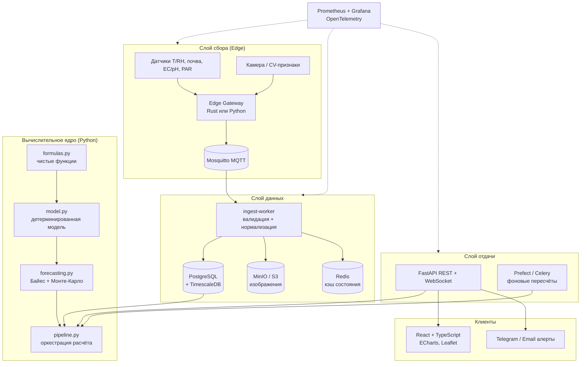
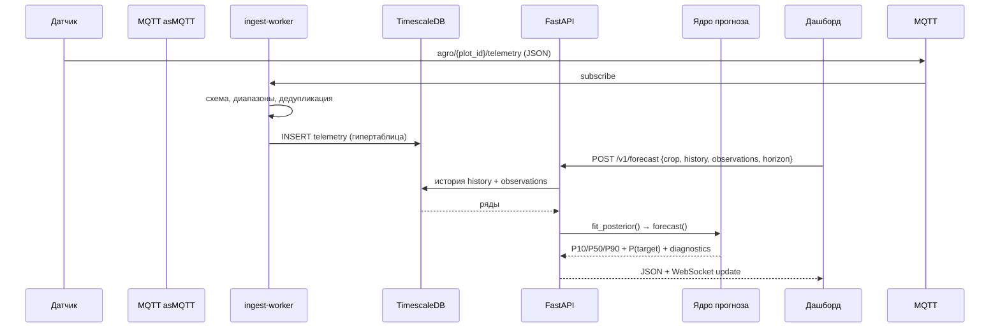

# Архитектура системы «АгроПрогноз»

**Назначение.** Оценка вероятностного роста и ожидаемого урожая плодовых культур и овощей по данным о состоянии растений/почвы/климата и математическим моделям роста.

**Ключевая идея.** Детерминированная физиологическая модель даёт *математическое ожидание* роста, а байесовский слой превращает разрозненные измерения в *распределение* исходов: P10/P50/P90 и вероятность достижения целевого урожая к заданной дате.

---

## 1. Границы и допущения

| Вопрос | Решение (принятое допущение) |
|---|---|
| Объект моделирования | Одно растение/теплица/поле как «ячейка» (`plot`). Площадь и густота задаются отдельно. |
| Источники данных | Сенсоры (T/RH, почва, EC/pH, PAR), агрометеопрогноз, ручные замеры массы/диаметра, снимки (опционально). |
| Горизонт | 1–120 суток с шагом 1 день. |
| Неопределимость | Параметры скорости роста `\mu` и потенциальной ёмкости `K` неизвестны — оцениваются по наблюдениям. Погода прогноза размывается шумом. |
| Язык ядра | Python 3.12+ (научный стек, читаемость формул). |
| Язык интерфейса | TypeScript + React (ECharts для «веера» прогноза). |
| Хранилище | PostgreSQL + TimescaleDB; объекты — S3/MinIO. |

> Допущения легко заменить: конфиг культуры вынесен в YAML, источник данных — за адаптером `DataSource`.

---

## 2. Концептуальная модель

```
CropProfile (справочник культуры)
   │  t_base, t_upper, GDD*, Kc*, VPD*, pH*, EC*, RUE, HI, ...
   ▼
Plot ──────< Telemetry (временные ряды)      # TimescaleDB hypertable
  │         < Observation (замеры массы/диаметра)
  │         < ImageSet (снимки, CV-признаки) # S3 + метаданные в БД
  ▼
PlotState (текущее состояние: θ, LAI, biomass, GDD, ETc)
   ▼
Posterior(μ, K)  ──►  Forecast (P10/P50/P90, P(target))
```

**Сущности:**

| Сущность | Смысл | Ключевые поля |
|---|---|---|
| `CropProfile` | Параметры физиологии культуры | `t_base`, `t_upper`, `gdd_to_maturity`, `kc_ini/mid/end`, `vpd_opt`, `ph_opt`, `ec_threshold`, `rue`, `harvest_index`, `dry_matter_fraction` |
| `Plot` | Участок/теплица | `id`, `crop_id`, `latitude`, `area_m2`, `plants_per_ha` |
| `DailyWeather` | Агрометео-день | `tmax`, `tmin`, `rh`, `par_umol`, `photoperiod_h`, `rain_mm`, `irrigation_mm` |
| `Observation` | Замер растения | `day`, `fresh_mass_g` или `diameter_mm` (аллометрия `m = a·d^b`) |
| `PlotState` | Состояние в момент t | `theta`, `lai`, `dry_biomass_g`, `gdd`, `cum_etc_mm` |
| `Posterior` | Распределение параметров | сетка `(μ, K)` + веса |
| `ForecastResult` | Результат | даты, `p10/p50/p90`, `probability_target`, `diagnostics` |

---

## 3. Математическое ядро

### 3.1 Фенология — сумма эффективных температур

\[
T_{avg}=\frac{T_{max}+T_{min}}{2},\qquad
GDD_d=\max\big(\min(T_{avg},T_{upper})-T_{base},\,0\big)
\]

\[
DVS=\frac{\sum GDD_d}{GDD_{maturity}}\in[0,1]
\]

`DVS` управляет коэффициентом транспирации `Kc` (кусочно-линейная интерполяция между `kc_ini → kc_mid → kc_end`).

### 3.2 Влагозапас воздуха

\[
e_s(T)=0.6108\exp\!\left(\frac{17.27T}{T+237.3}\right)\ [кПа],\qquad
VPD=e_s(T)\left(1-\frac{RH}{100}\right)
\]

### 3.3 Эвапотранспирация (Hargreaves + FAO-56)

\[
ET_0=0.0023\,R_a\,(T_{avg}+17.8)\sqrt{T_{max}-T_{min}}
\]

\(R_a\) — внеземная радиация по дню года и широте.Fact

\[
ET_c=ET_0\cdot K_c(DVS)\cdot K_s,\qquad
K_s=\begin{cases}
1, & D\le RAW\\
\dfrac{TAW-D}{TAW-RAW}, & D>RAW
\end{cases}
\]

\[
TAW=(\theta_{fc}-\theta_{wp})Z_r,\quad RAW=p\cdot TAW,\quad D=(\theta_{fc}-\theta)Z_r
\]

Баланс почвенной влаги:

\[
\theta_{t+1}=\min\!\left(\theta_t+\frac{P+I-ET_c}{Z_r},\ \theta_{fc}\right)
\]

### 3.4 Свет и радиация

\[
DLI=\frac{PAR_{\mu mol}\cdot h_{photo}\cdot 3600}{10^6}\ [моль/м^2/сут],\qquad
PAR_{MJ}=0.235\cdot DLI
\]

\[
fPAR=1-e^{-k_{ext}\cdot LAI},\qquad APAR=PAR_{MJ}\cdot fPAR
\]

### 3.5 Стресс-факторы (диагностируемость!)

Каждый фактор — число `[0,1]`, произведение даёт итоговый стресс:

| Фактор | Формула (идея) |
|---|---|
| Температура | трапеция: 0 ниже `T_crit`, 1 в `[T_opt_lo, T_opt_hi]`, 0 выше `T_crit_hi` |
| VPD | 1 в оптимуме, линейный спад к критическому |
| pH | трапеция вокруг `pH_opt ± tol` |
| EC | \(1-\max(EC-EC_{thr},0)/s\) |
| Вода | `Ks` из §3.3 |

\[
S=\prod_i S_i
\]

Каждый множитель отдаётся в API — пользователь видит, *почему* прогноз снизился (засуха, жара, засоление).

### 3.6 Рост биомассы (закон минимума + логистика)

\[
\Delta W_{pot}=W\left(1-\frac{W}{K}\right)\mu,\qquad
\Delta W_{rad}=RUE\cdot APAR
\]

\[
W_{t+1}=W_t+\min(\Delta W_{pot},\Delta W_{rad})\cdot S
\]

`K` — потенциальная ёмкость (генетический потолок), `μ` — скорость. Оба неизвестны → оцениваются (§3.8).

### 3.7 Урожай

\[
M_{fruit}=\frac{W\cdot HI}{DMF},\qquad
Y=\frac{M_{fruit}\cdot plants_{ha}}{10^6}\ [т/га]
\]

`HI` — harvest index, `DMF` — доля сухого вещества в плоде.

### 3.8 Байесовское обновление параметров

Сетчатый фильтр: задаём сетку `(μ_i, K_j)`, для каждой пары прогоняем модель по истории погоды и считаем правдоподобие наблюдений в логарифмической шкале:

\[
\log L_{ij}=-\sum_k\frac{\big(\ln m_k^{obs}-\ln \hat m_k(\mu_i,K_j)\big)^2}{2\sigma^2}
\]

\[
w_{ij}=\frac{\exp(\log L_{ij})}{\sum_{ab}\exp(\log L_{ab})}
\]

Это устойчивее градиентных методов при 5–30 замерах и даёт честную неопределённость.

### 3.9 Вероятностный прогноз

1. Сэмплируем `(μ, K)` из апостериори.
2. Добавляем шум к прогнозу погоды (температура, RH) — ансамбль.
3. Прогоняем модель по каждому сценарию → `N` траекторий урожая.
4. Квантили 10/50/90 % по каждому дню + \(P(Y_{end}\ge Y_{target})\).

Результат — «веер» прогноза, а не одна цифра.

---

## 4. Компонентная схема



---

## 5. Поток данных (sequence)



---

## 6. Слои и ответственность

| Слой | Технологии | Ответственность | Чего НЕ делает |
|---|---|---|---|
| Edge | Rust/Go или Python, MQTT | Сбор, буферизация офлайн, подпись телеметрии | Аналитика |
| Ingestion | Python + paho-mqtt + Pydantic | Валидация, нормализация единиц, QC-флаги | Бизнес-прогноз |
| Storage | TimescaleDB, Redis, MinIO | Временные ряды, состояние, изображения | Вычисления |
| Model core | Python (numpy, dataclasses) | Формулы, стрессы, рост, байес, ансамбль | I/O, сеть |
| Orchestration | Prefect (или Airflow) | Пересчёт по расписанию/событию, версионирование прогонов | Формулы |
| API | FastAPI, Pydantic v2 | Контракты, авторизация, WebSocket | Тяжёлые расчёты в потоке запроса |
| Frontend | React, TypeScript, ECharts, Leaflet | Визуализация веера, объяснение стрессов | Расчёт прогноза |
| Observability | Prometheus, Grafana, OTel | Метрики, трейсы, алерты деградации данных | — |

**Почему именно так:** ядро — чистые функции без I/O ⇒ его можно тестировать на синтетике и переиспользовать в Jupyter, API и batch-воркере. Тяжёлый Монте-Карло вынесен в воркер; API отдаёт кэш из Redis с TTL 5–15 мин.

---

## 7. Схема данных (TimescaleDB)

```sql
CREATE TABLE plots (
  id            TEXT PRIMARY KEY,
  crop_id       TEXT NOT NULL REFERENCES crops(id),
  latitude      REAL NOT NULL,
  longitude     REAL NOT NULL,
  area_m2       REAL NOT NULL,
  plants_per_ha INTEGER NOT NULL
);

CREATE TABLE telemetry (
  time        TIMESTAMPTZ NOT NULL,
  plot_id     TEXT NOT NULL REFERENCES plots(id),
  tmax        REAL, tmin REAL, rh REAL,
  par_umol    REAL, photoperiod_h REAL,
  rain_mm     REAL, irrigation_mm REAL,
  soil_theta  REAL, soil_ph REAL, soil_ec REAL,
  qc_flag     TEXT DEFAULT 'ok'
);
SELECT create_hypertable('telemetry', 'time');
CREATE INDEX ON telemetry (plot_id, time DESC);

CREATE TABLE observations (
  time          TIMESTAMPTZ NOT NULL,
  plot_id       TEXT NOT NULL,
  fresh_mass_g  REAL,
  diameter_mm   REAL,
  source        TEXT
);
SELECT create_hypertable('observations', 'time');

CREATE TABLE forecasts (
  id           UUID PRIMARY KEY,
  plot_id      TEXT NOT NULL,
  created_at   TIMESTAMPTZ DEFAULT now(),
  target_t_ha  REAL,
  p50_end      REAL,
  p_target     REAL,
  payload      JSONB NOT NULL   -- полный веер + диагностика
);

-- Сжатие старых партиций
ALTER TABLE telemetry SET (
  timescaledb.compress,
  timescaledb.compress_segmentby = 'plot_id'
);
SELECT add_compression_policy('telemetry', INTERVAL '30 days');
```

---

## 8. Контракты

### MQTT

| Топик | Направление | Payload |
|---|---|---|
| `agro/{plot_id}/telemetry` | датчик → система | `{ts, tmax, tmin, rh, par_umol, soil_theta, soil_ph, soil_ec}` |
| `agro/{plot_id}/observation` | оператор → система | `{ts, diameter_mm \| fresh_mass_g}` |
| `agro/events/{plot_id}/alert` | система → подписчики | `{type, severity, message}` |

### REST (FastAPI)

| Метод | Путь | Назначение |
|---|---|---|
| `GET` | `/health` | liveness/readiness |
| `GET` | `/v1/crops` | справочник культур |
| `GET` | `/v1/plots/{id}/latest` | последнее состояние + стрессы |
| `POST` | `/v1/observations` | добавить замер → триггер пересчёта |
| `POST` | `/v1/forecast` | расчёт прогноза |
| `GET` | `/v1/forecasts/{id}` | сохранённый прогноз |

Пример ответа `/v1/forecast`:

```json
{
  "plot_id": "greenhouse-3",
  "days": ["2026-05-01", "2026-05-02"],
  "p10_t_ha": [0.0, 0.3],
  "p50_t_ha": [0.0, 0.5],
  "p90_t_ha": [0.1, 0.8],
  "probability_target": 0.72,
  "diagnostics": {"water": 0.61, "temperature": 1.0, "vpd": 0.88, "ec": 1.0}
}
```

### WebSocket

`WS /v1/plots/{id}/stream` — push новых прогнозов и алертов без polling.

---

## 9. Структура репозитория

```text
agro-growth/
├── ARCHITECTURE.md              # этот документ
├── README.md
├── pyproject.toml
├── docker-compose.yml
├── Dockerfile
├── configs/crops/
│   ├── tomato.yaml
│   └── cucumber.yaml            # добавляется по мере нужды
├── db/schema.sql
├── src/agro_growth/
│   ├── domain.py                # dataclasses, загрузка профиля
│   ├── formulas.py              # чистые математические функции
│   ├── model.py                 # детерминированный пошаговый рост
│   ├── forecasting.py           # байес + Монте-Карло
│   ├── pipeline.py              # сборка: данные → прогноз
│   ├── api.py                   # FastAPI
│   ├── ingestion.py             # MQTT → валидация → БД
│   └── storage.py               # репозитории (TimescaleDB/Redis)
├── tests/test_core.py
└── web/
    ├── package.json
    ├── tsconfig.json
    └── src/App.tsx              # веер прогноза + диагностика
```

---

## 10. Технологический стек и обоснование

| Компонент | Выбор | Почему |
|---|---|---|
| Ядро | Python 3.12, numpy, dataclasses | Формулы читаемы, легко проверять,огромная экосистема |
| Валидация | Pydantic v2 | Контракты и ошибки из коробки |
| API | FastAPI | Async, OpenAPI-документация, WebSocket |
| БД | PostgreSQL + TimescaleDB | SQL + эффективные временные ряды и сжатие |
| Очередь | MQTT (Mosquitto) | Лёгкий, стандарт IoT, работа на слабом железе |
| Фон | Prefect → Celery | Версионирование прогонов, повторы, расписания |
| Кэш | Redis | Быстрая отдача последнего прогноза |
| CV (этап 2) | OpenCV + ONNX Runtime на edge | Оценка площади листьев/пятен без облака |
| Frontend | React + TS + ECharts + Leaflet | Интерактивный веер прогноза и карта участков |
| Инфраструктура | Docker Compose → Kubernetes | От прототипа к масштабу без смены кода |
| Наблюдаемость | OpenTelemetry + Prometheus + Grafana | Сквозные трейсы от датчика до прогноза |

---

## 11. Надёжность и качество данных

1. **QC на входе:** диапазоны (T −40…60 °C, RH 0…100, θ 0…1), проверка монотонности времени, дедупликация по `(plot_id, ts)`.
2. **Пропуски:** линейная интерполяция ≤ 6 ч; больше — пометка `qc_flag='gap'`, прогноз получает расширенный шум.
3. **Дрейф датчика:** сравнение с агрометео-прогнозом, флаг `drift` при расхождении > 3 σ.
4. **Деградация модели:** мониторинг `CRPS`/`MAE` по фактическим замерам; при ухудшении — пересмотр априорных сеток и переобучение allometry.
5. **Идемпотентность:** каждый прогноз имеет `id` и версию конфига культуры; пересчёт не портит историю.

---

## 12. Безопасность

- MQTT: TLS + персональные сертификаты/токены на устройство; ACL по топикам `{plot_id}`.
- API: JWT/OIDC, role-based (`viewer`, `operator`, `admin`).
- Секреты — Docker/K8s secrets, не в YAML культур.
- Аудит записи замеров и изменений конфигов.
- Снимки хранятся с подписью; доступ по presigned URL.

---

## 13. Производительность

| Нагрузка | Подход |
|---|---|
| 1000 участков × 1 мин | TimescaleDB continuous aggregates по часам/дням |
| Ансамбль 2000 траекторий × 120 дней | numpy-векторизация + отдельный воркер; цель < 2 c на прогноз |
| Медленный API | Redis-кэш с invalidation по событию новой телеметрии |
| Рост данных | Сжатие партиций старше 30 дней, retention 2–5 лет |

---

## 14. Тестирование

- **Unit:** каждая формула на эталонных значениях (GDD, VPD, ET0, Ks, логистика).
- **Property:** `0 ≤ S ≤ 1`, `p10 ≤ p50 ≤ p90`, монотонность биомассы при росте μ.
- **Integration:** synthetic weather + известные параметры → апостериори сходится к ним.
- **Contract:** Pydantic-схемы API, OpenAPI snapshot.
- **Hardware-in-the-loop:** эмулятор MQTT-датчика с шумом и пропусками.

---

## 15. Этапы внедрения

| Этап | Результат | Критерий готовности |
|---|---|---|
| **P0 (сейчас)** | математическое ядро + конфиг томата + юнит-тесты + прототип API | Формулы покрыты тестами, прогноз считается на синтетике |
| **P1** | MQTT-инжест, TimescaleDB, кэш, Docker Compose | Данные идут от эмулятора датчика до дашборда |
| **P2** | React-дашборд: веер прогноза, стрессы, алерты | Пользователь видит P10/P50/P90 и причины снижения |
| **P3** | CV-признаки снимков (LAI, пятна), дообучение allometry | Рост точности на исторических данных |
| **P4** | Prefect, multi-crop, Kubernetes, мониторинг дрейфа | 1000+ участков, SLO на время прогноза |

---

## 16. Риски и меры

| Риск | Митигация |
|---|---|
| Мало замеров → широкий прогноз | Априорные сетки из справочника культуры; активный опрос оператора |
| Прогноз погоды неточный | Ансамбль с шумом,показано в веере; не точечная цифра |
| Неверные единицы от датчика | Жёсткая нормализация в `ingestion.py`, QC-флаги |
| Переобучение под одну теплицу | Версионирование профилей, кросс-валидация по участкам |
| Сложность объяснения пользователю | Диагностика стрессов в ответе API и на графике |

---

## 17. Быстрый старт прототипа

```bash
python -m unittest discover -s tests -v
python -m agro_growth.pipeline --demo
```

Демо генерирует синтетическую погоду, подгоняет апостериори по замерам и печатает P10/P50/P90.
